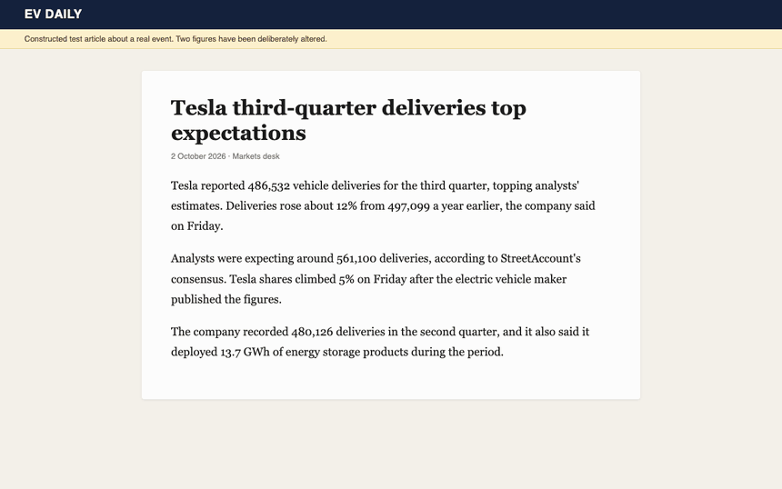
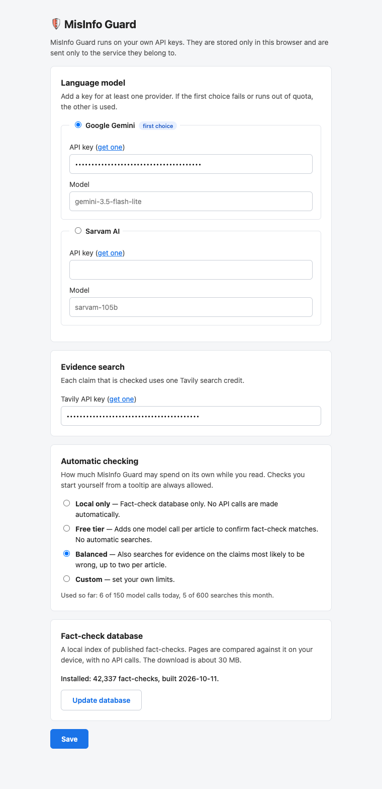
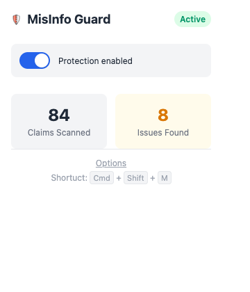

# MisInfo Guard

A Chrome extension that fact checks every article you read. It highlights claims that published fact-checks or reputable outlets contradict, along with the evidence


- A sentence turns red only when a published fact-check matches it, or when a trusted source contradicts it.
- Most of the work happens in your browser. A typical article costs two model calls and at most two searches, within a budget you can set.
- The application runs on your own API keys, which stay in the browser.

## What it looks like

### Verifies accurate reports


A workking example on BBC's website. One sentence is marked green, with the matching passage from NPR's report of the same story.

### Flags altered figures



When a number disagrees with other coverage of the same story, the tooltip puts the two side by side: "This article: 12% · Source: 2%". This page is a test article written for the recording, because real outlets rarely print wrong figures. It describes Tesla's real third-quarter 2026 deliveries with two figures changed. Both altered sentences turn red, while the unaltered ones remain green.

### What the highlights mean

| Underline | Meaning |
|---|---|
| Red | A published fact-check disputes this claim, or a trusted source contradicts it. The tooltip shows the rating or the quote, with a link. |
| Green | A trusted source supports it. The tooltip shows the quote. |
| Amber | It resembles a claim in the fact-check database, but the match has not been confirmed. |
| Faint dotted | A claim that was detected but not checked. Its tooltip offers a manual check for one search. |

### Settings

<table>
<tr>
<td valign="top"></td>
<td valign="top"></td>
</tr>
</table>

More working examples are in [docs/demo](docs/demo/).

## How it works

The workflow is as follow:

1. **Find the claims.** The content script reads the headline and the article text and splits it into sentences. A small TinyBERT model trained on ClaimBuster data runs inside the extension and picks the check-worthy ones. Everything happens in the browser.
2. **Fact-check memory.** Every sentence is compared, on your device, against a local index of about 42,000 published fact-checks. This verification layer is free.
3. **Triage.** One model call covers the whole page. It confirms or rejects the fact-check matches, and estimates which other claims are likely to be wrong. Triage only decides what to check next; it is never shown as a verdict.
4. **Evidence search.** A scheduler spends searches within your budget. The claims most likely to be wrong get a search each. Another search fetches how trusted outlets covered the same story.
5. **Judge.** One more model call compares the claims with the evidence. 
6. **Quote check.** A verdict is kept only if its quote can be found in the source text. 

Conclusions are cached, so the same claim on another page (which happens ofen when browsing pages on similar topic), or the same page on a second visit, costs nothing.

## Installation 

MisInfo Guard is not on the Chrome Web Store yet, so it is built from source. You need Node 18 or later.

```bash
git clone https://github.com/raghavthind2005/MisInfo-Guard.git
cd MisInfo-Guard/extension
npm install
npm run build
```

The first build downloads the two small models the extension runs in the browser.

1. Open `chrome://extensions` and turn on **Developer mode**.
2. Choose **Load unpacked** and select the `extension/dist` folder.
3. Open the extension's options page.
4. Click **Download database** to install the fact-check memory (about 30 MB). This alone is enough for the *Local only* budget.
5. For the full pipeline, add a key for a language model ([Google Gemini](https://aistudio.google.com/apikey) or [Sarvam AI](https://www.sarvam.ai)) and a [Tavily](https://app.tavily.com) key for search.

## Budgets and cost

You can choose how much the extension may spend.

| Preset | What runs automatically | Limits |
|---|---|---|
| Local only | The fact-check memory | No API calls |
| Free tier | Adds the triage call, which confirms fact-check matches | 100 model calls a day, no searches |
| Balanced | Adds evidence search on the claims most likely to be wrong | 150 model calls a day, 600 searches a month, two per article |
| Custom | Your own limits | |

The scheduler spreads the monthly search allowance over the days left in the month. Tavily's free plan includes 1,000 search credits a month, and Gemini has a free tier, so the Balanced preset is meant to fit inside both. Check each provider's current limits before relying on that.

Any provider with an OpenAI-style chat endpoint can be added as a preset in [provider.ts](extension/src/llm/provider.ts). If the primary provider fails or runs out of quota, the next one configured is tried.

## How well it works

`extension/eval/claims.json` holds 70 labelled claims: well-known facts, subtly wrong figures and dates, surprising true statements, claims no model could know, and recent claims rated by professional fact-checkers. With Gemini (`gemini-3.5-flash-lite`):

| Stage | Result |
|---|---|
| Triage | Flags 27 of 35 false claims for checking, and 0 of 29 true ones |
| Judge, after one search per claim | 19 of 26 verdicts correct; no true claim shown as contradicted |

The numbers move by one or two between runs, because live search results change. The design is biased towards missing a false claim rather than mislabelling a true one.

To run it yourself:

```bash
cp .env.example .env        # fill in your keys
cd extension
npm run eval -- --providers gemini,sarvam --verbose
npm test                    # unit tests
```

Search results are cached, so reruns do not spend credits.

## Limitations

- **The extenstion still misses things.** Many checks end as "No clear evidence found", and a false claim that no fact-checker or trusted outlet has addressed will not be flagged.
- **Figure comparison needs a publish date.** Coverage of the same story is found by date, so pages without one skip that step.
- **Results vary between visits,** since they rely on live search results.
- **A highlight is a pointer to evidence, not a final answer.** Read the source before deciding.

## Rebuilding the fact-check database

The index is built from the [Data Commons ClaimReview feed](https://datacommons.org/factcheck/download) (CC BY), topped up with recent fact-checks listed by the Google Fact Check Tools API. It needs to be rebuilt by the user : open the repository's **Actions** tab, choose **Build fact-check index** and click **Run workflow**. Add a `GOOGLE_FACTCHECK_API_KEY` repository secret to include the recent top-up. Without the key the index is built from the feed alone.

To build and calibrate it locally:

```bash
node extension/scripts/fetch-models.mjs
pip install -r scripts/requirements.txt
python scripts/build_factcheck_index.py --out factcheck-index
cd extension && npm run eval:memory -- --verbose
```

## Repository layout

| Path | What it is |
|------|------------|
| `extension/src/content/` | Page scanning, highlighting and the tooltip |
| `extension/src/ml/` | In-browser claim detection and sentence embeddings |
| `extension/src/memory/` | Fact-check memory: index search, download and storage |
| `extension/src/verify/` | Page analysis: triage, scheduler, budgets, cross-coverage, number comparison, judge, quote check and cache |
| `extension/src/llm/` | Provider-agnostic chat client and fallback chain |
| `extension/src/search/` | Evidence search and the trusted domain list |
| `extension/src/options/`, `extension/src/popup/` | Options page and toolbar popup |
| `extension/eval/` | Labelled claims and the evaluation harness |
| `extension/tests/` | Unit tests |
| `scripts/` | Python scripts that build the fact-check index and export the claim detection model |
| `.github/workflows/` | Manually triggered workflow that publishes the fact-check index |

## Sources, and where this can improve

A claim is checked against two things. The first is the published fact-checks: the [Data Commons ClaimReview feed](https://datacommons.org/factcheck/download) and the Google Fact Check Tools API, which together cover fact-checkers such as Snopes, PolitiFact, Full Fact, AFP, BOOM and Alt News, and the second is a fixed list of sites that search is restricted to, kept in [trustedDomains.ts](extension/src/search/trustedDomains.ts): wire services and broadcasters (Reuters, AP, BBC, NPR), newspapers of record, the fact-checkers above, and reference and official sources (Britannica, Wikipedia, WHO, CDC, NASA, Our World in Data). The language model never serves as a source, it only compares a claim with what those sources say.

This list is a judgement call. It leans towards English-language and US, UK and Indian outlets, the fact-check feed is growing more slowly than it used to, and a trusted outlet can still be wrong. You can improve the accuraccy by choosing if you know a better way to choose sources, find evidence or match claims to fact-checks.

## License

[MIT](LICENSE)
