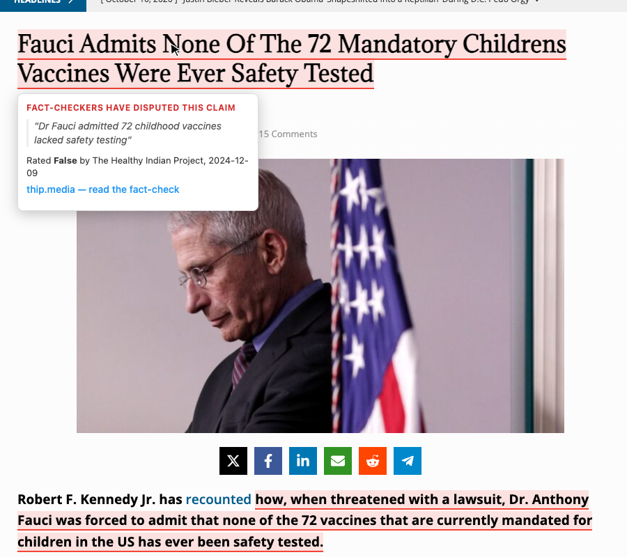
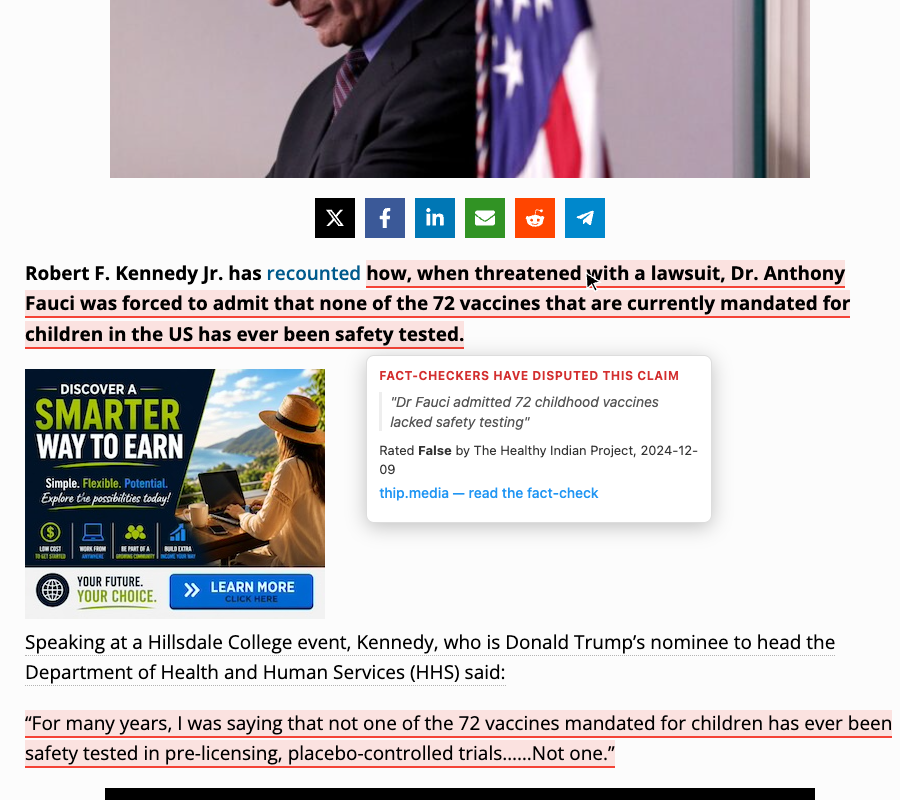
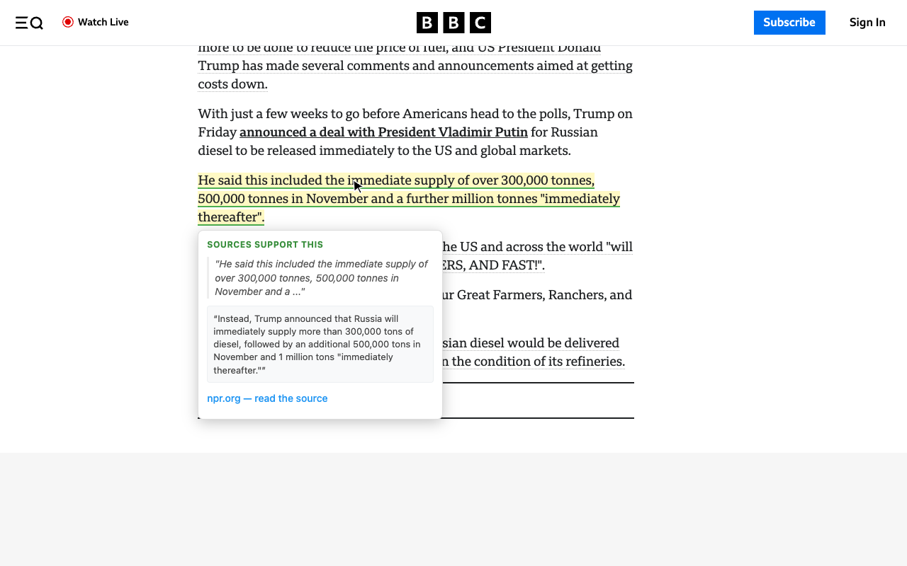
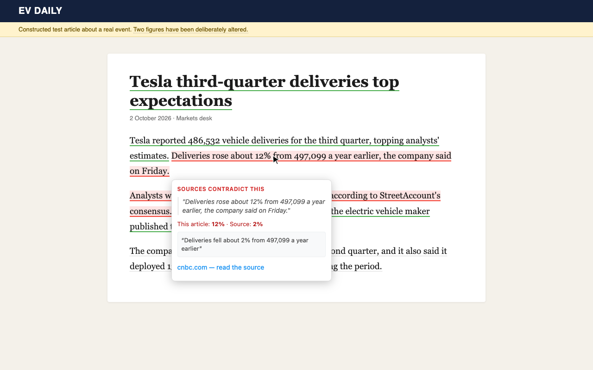
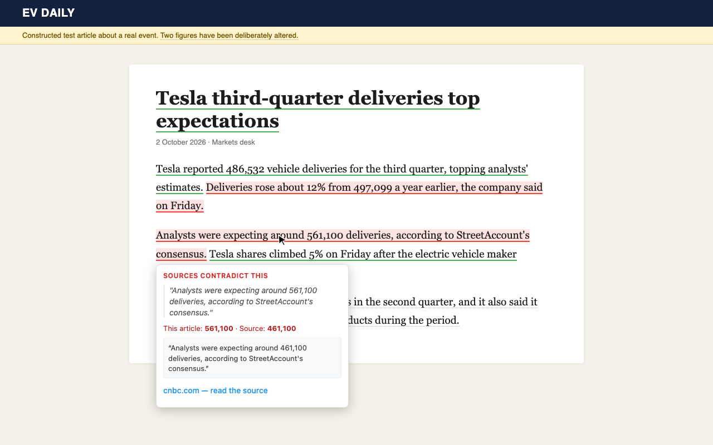
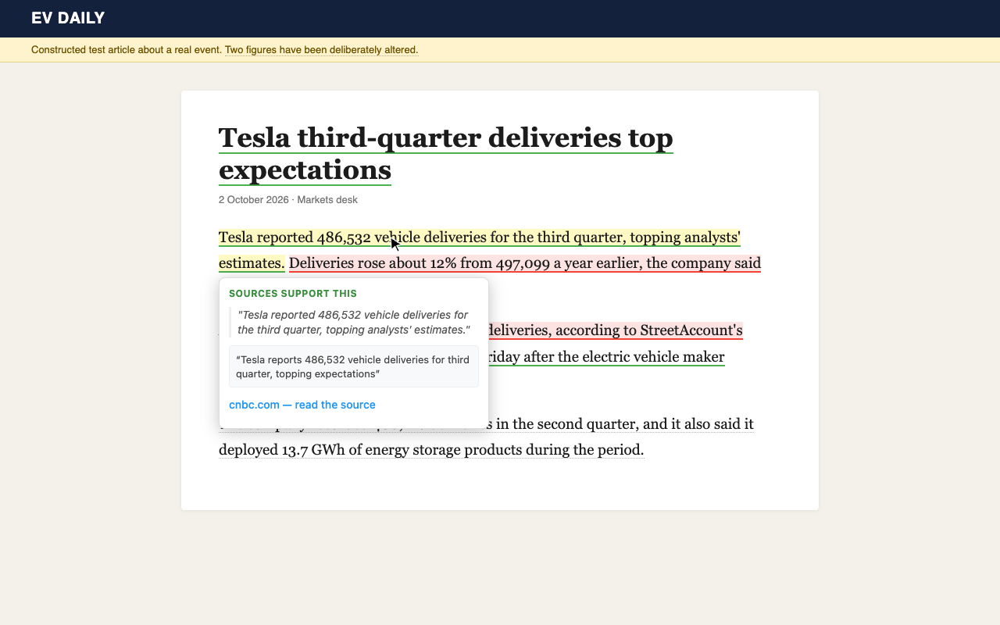

# Demo captures

Every image here was recorded with the built extension loaded in Chromium, using the Balanced budget, a Gemini key and a Tavily key. 

How the recordings were made:

- **Captured on 11 October 2026.** Live search results change, so a later run may flag different sentences.
- **Cookie banners and ad frames were hidden** so the article text is visible.
- **The fact-check database was built locally** with `scripts/build_factcheck_index.py`, the same script the publishing workflow runs.
- **The third scene is a test article,** not a real site. The first two are real pages.

## 1. An article repeating a debunked claim

Each tooltip shows the published fact-check it matches and that fact-checker's rating.

| Headline | Body |
|---|---|
|  |  |

## 2. A real BBC News article

Nothing is flagged. One sentence is marked as supported, with the matching passage from NPR's report of the same story.

## 3. A test article with two altered figures

The page describes Tesla's real third-quarter 2026 deliveries, with two figures changed. Both altered sentences turn red, and the tooltip shows the article's number beside the source's. The unaltered sentences turn green.

| First altered figure | Second altered figure | An unaltered sentence |
|---|---|---|
|  |  |  |

## Options page and popup

| Options | Popup |
|---|---|
|  |  |
